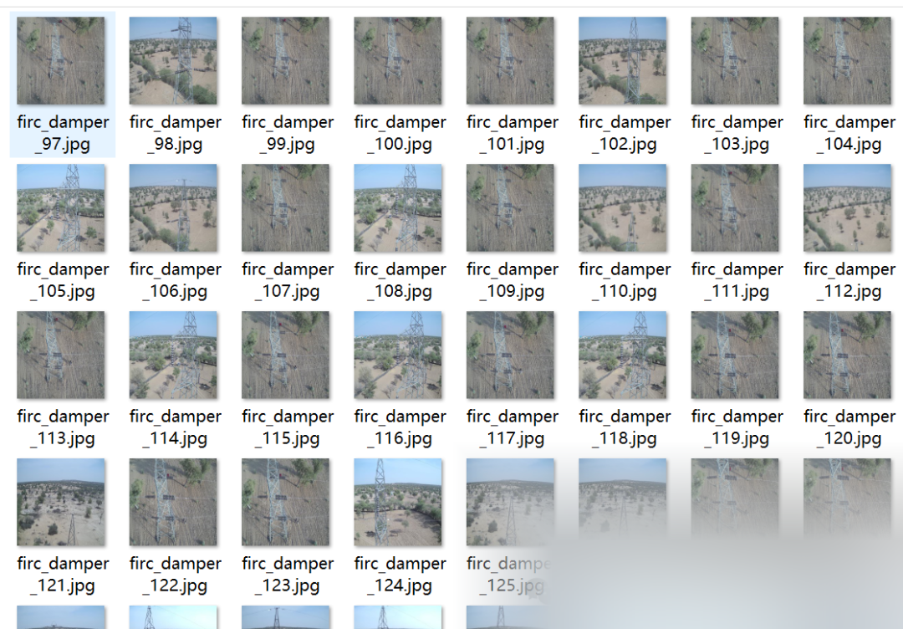
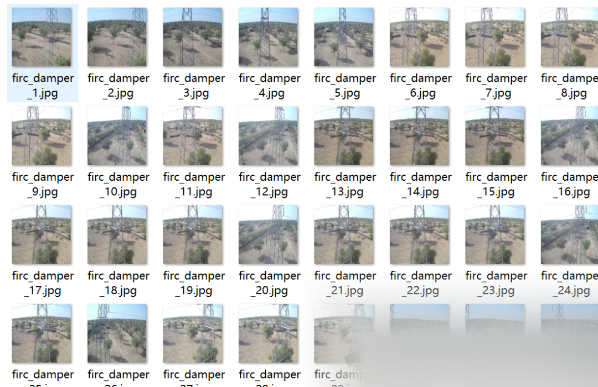
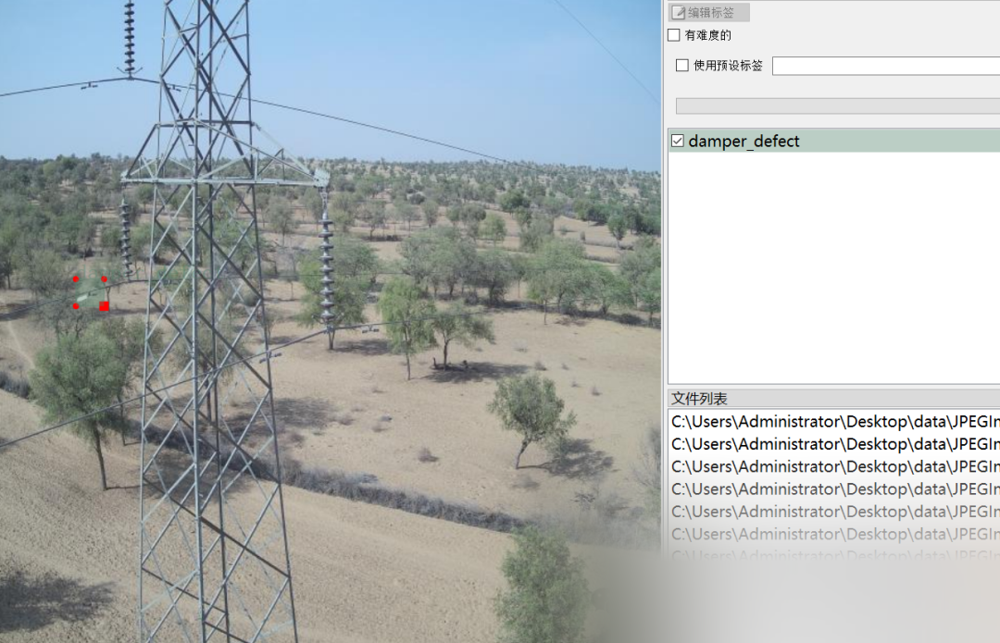

# [Dataset] [Object Detection] Power Scenario Vibration Hammer Defect Detection Dataset VOC+YOLO format with 705 images in 1 category

Important Notice: It is difficult to find defect images of shock absorber, the dataset contains a large number of single scene images. Please carefully review the image previews before downloading and note that all datasets are for small object detection. If the training map is low, it is normal.

Dataset format: Pascal VOC format + YOLO format (txt file without split path, only containing jpg images and corresponding VOC format xml files and yolo format txt files)

Number of images (number of jpg files): 705

Number of annotations (number of xml files): 705

Number of annotations (number of txt files): 705

Label category count: 1

Label category name: ["damper_defect"]

Number of boxes labeled in each category:

damper_defect frame count = 706

Total frame count: 706

Using labelImg:

Annotation rules: Draw a rectangle around the category.

Special : This dataset does not guarantee the accuracy or precision of the trained models or weight files. The dataset is provided with accurate and reasonable annotations only.

Image Preview:

Annotation example:

## Payment

Here is a pay link on Stripe ( https://buy.stripe.com/3cs8yP7sY87d0vu9AB ). Please contact me lonlonago@foxmail.com after funding $89, and I will send you a complete data files , thank you!

